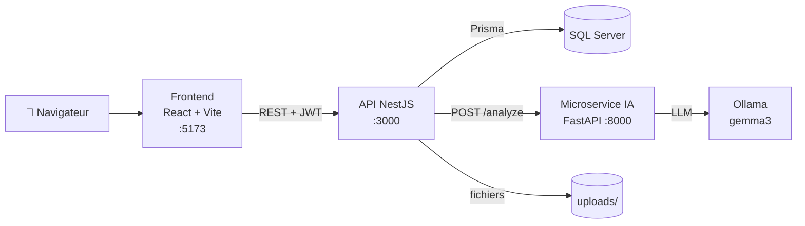

<div align="center">

# 🏛️ SAWTI : Plateforme de gestion des réclamations de la Commune de Berkane

**Une application web full stack qui permet aux citoyens de déposer et de suivre leurs réclamations, et aux agents communaux de les traiter avec l'aide d'une IA locale.**

*« Votre voix, notre action »*

</div>

---

## 📑 Sommaire

- [Présentation](#-présentation)
- [Fonctionnalités](#-fonctionnalités)
- [Architecture](#-architecture)
- [Technologies utilisées](#-technologies-utilisées)
- [Structure du projet](#-structure-du-projet)
- [Installation](#-installation)
- [Variables d'environnement](#-variables-denvironnement)
- [Utilisation](#-utilisation)
- [Tests et qualité du code](#-tests-et-qualité-du-code)
- [Pistes d'amélioration](#-pistes-damélioration)
- [Auteur](#-auteur)

---

## 🎯 Présentation

**SAWTI** est une plateforme numérique de gestion des réclamations de la **Commune de Berkane**. Elle permet aux citoyens de déposer leurs réclamations en ligne, de suivre leur traitement et de recevoir des notifications, tandis que les agents et les administrateurs disposent d'un espace de traitement complet.

Chaque nouvelle réclamation est analysée par un **microservice d'intelligence artificielle** (Gemma 3 exécuté en local via Ollama). L'IA propose une catégorie, un département, un service, un niveau de priorité, un indice de confiance et un **brouillon de réponse**. Ces propositions ne sont jamais définitives : elles restent **soumises à la validation d'un agent**, qui peut les corriger avant d'envoyer la réponse finale au citoyen.

L'application repose sur trois services indépendants :

- un **frontend** React,
- une **API** NestJS reliée à SQL Server via Prisma,
- un **microservice IA** FastAPI qui communique avec Ollama.

> L'interface est entièrement en français.

---

## ✨ Fonctionnalités

### 👤 Espace citoyen

| Fonctionnalité | Description |
|---|---|
| **Compte** | Inscription et connexion (les nouveaux comptes ont le rôle `CITOYEN`). |
| **Dépôt d'une réclamation** | Titre, description, numéro et date du bureau d'ordre, date de réception, personne ou service mis en cause, département, service et priorité. |
| **Pièces jointes** | Ajout de fichiers **PDF, JPEG ou PNG** (5 Mo maximum par fichier), consultables et téléchargeables de façon protégée. |
| **Suivi** | Liste de ses propres réclamations, page de détail avec statut, priorité, **historique des actions** et réponse finale. |
| **Notifications** | Notifications à l'enregistrement de la réclamation, à chaque changement de statut, à la vérification par un agent et à l'envoi de la réponse. Compteur de non lues, marquage comme lue (une par une ou toutes). |

### 🧑‍💼 Espace agent

| Fonctionnalité | Description |
|---|---|
| **Tableau de bord** | Liste de toutes les réclamations, statistiques par statut et par priorité, recherche et filtres (statut, priorité, service, etc.). |
| **Validation de l'IA** | Validation ou correction de la classification proposée par l'IA (catégorie, département, service, priorité). |
| **Réponse au citoyen** | Modification du brouillon de réponse proposé par l'IA puis envoi de la **réponse finale** (un seul envoi autorisé par réclamation), avec notification au citoyen. |
| **Statuts** | Changement de statut : `EN_ATTENTE`, `EN_COURS`, `TRAITEE`, `REJETEE`, avec entrée dans l'historique et notification du citoyen. |
| **Exports** | Export de la liste des réclamations en **CSV** et en **PDF**. |

### 🛡️ Espace administrateur

| Fonctionnalité | Description |
|---|---|
| **Tout ce que fait l'agent** | Tableau de bord, validation de l'IA, réponses, statuts et exports. |
| **Gestion des réclamations** | Modification et suppression d'une réclamation. |
| **Gestion des utilisateurs** | Liste des comptes, modification du nom et du **rôle** (`CITOYEN`, `AGENT`, `ADMIN`), **activation / désactivation** d'un compte, suppression. Un compte désactivé ne peut plus se connecter. |

### 🤖 Analyse par l'IA

À la création d'une réclamation, l'API appelle le microservice IA, qui renvoie un JSON validé :

| Champ | Contenu |
|---|---|
| `categorie` | Catégorie courte (éclairage public, voirie, propreté, eau et assainissement, espaces verts, urbanisme, transport, sécurité, administration, autre) |
| `departement` / `service` | Département et service municipal les plus pertinents |
| `priorite` | `BASSE`, `NORMALE`, `HAUTE` ou `URGENTE` |
| `confiance` | Indice de confiance entre 0 et 1 |
| `reponse` | Brouillon de réponse administrative en français (2 à 4 phrases) |

Le modèle est appelé avec une température de 0 et une sortie contrainte par un schéma JSON. Si le microservice est indisponible, **la réclamation est tout de même enregistrée** (sans analyse IA) et l'historique l'indique.

### 🔒 Sécurité

- Mots de passe hachés avec **bcrypt**.
- Authentification par **JWT** (durée de validité d'une heure).
- **Contrôle d'accès par rôles** (`CITOYEN`, `AGENT`, `ADMIN`) sur les routes sensibles.
- Un citoyen n'accède qu'à ses propres réclamations et fichiers.
- Validation stricte des données entrantes (`whitelist` et `forbidNonWhitelisted`).
- Comptes désactivables par l'administrateur.

---

## 🏗️ Architecture



**Cycle de vie d'une réclamation :**

1. Le citoyen dépose sa réclamation (et ses pièces jointes) depuis le frontend.
2. L'API demande une analyse au microservice IA, calcule le numéro de classement, enregistre la réclamation, crée l'entrée d'historique initiale et notifie le citoyen.
3. Un agent ouvre la réclamation, **valide ou corrige** la classification de l'IA, puis fait évoluer le statut.
4. L'agent relit le brouillon de réponse, le modifie si besoin et **envoie la réponse finale** : le citoyen est notifié.

**Modèle de données (Prisma) :** `User`, `Reclamation`, `FichierJoint`, `HistoriqueReclamation`, `Notification`.

**Points d'entrée principaux de l'API**

| Domaine | Routes |
|---|---|
| **Auth** | `POST /auth/register`, `POST /auth/login` |
| **Réclamations** | `GET /reclamations` (agent/admin), `GET /reclamations/mes` (citoyen), `GET /reclamations/statistiques`, `GET /reclamations/:id`, `POST /reclamations`, `PATCH /reclamations/:id`, `PATCH /reclamations/:id/analyse-ia`, `POST /reclamations/:id/reponse`, `PATCH /reclamations/:id/statut`, `DELETE /reclamations/:id` |
| **Fichiers** | `GET/POST /reclamations/:id/fichiers`, `GET /reclamations/:id/fichiers/:fichierId/telecharger`, `DELETE /reclamations/:id/fichiers/:fichierId` |
| **Notifications** | `GET /notifications`, `GET /notifications/non-lues`, `GET /notifications/non-lues/count`, `PATCH /notifications/:id/lue`, `PATCH /notifications/toutes/lues` |
| **Utilisateurs** (admin) | `GET /users`, `GET /users/:id`, `PATCH /users/:id`, `DELETE /users/:id` |

**Microservice IA**

| Endpoint | Rôle |
|---|---|
| `GET /` | Informations sur le service |
| `GET /health` | État du service et de la connexion à Ollama |
| `POST /analyze` | Analyse d'une réclamation (titre + description) |

---

## 🛠️ Technologies utilisées

| Couche | Technologies |
|---|---|
| **Frontend** | React 19, TypeScript, Vite, React Router, jsPDF + jspdf-autotable (export PDF) |
| **Backend** | NestJS, TypeScript, Prisma ORM, Passport (JWT), bcrypt, class-validator / class-transformer, Multer (upload) |
| **Base de données** | Microsoft SQL Server |
| **Microservice IA** | Python, FastAPI, Pydantic, Ollama (modèle **Gemma 3**) |
| **Qualité** | Jest, Supertest, Oxlint, Prettier |

---

## 📂 Structure du projet

```
plateforme-reclamations-berkane/
├── ai-service/                  # Microservice IA (FastAPI + Ollama)
│   ├── app/main.py
│   └── requirements.txt
├── backend/                     # API NestJS
│   ├── prisma/
│   │   ├── schema.prisma        # Modèle de données
│   │   └── migrations/          # Migrations SQL Server
│   ├── src/
│   │   ├── auth/                # Inscription, connexion, JWT
│   │   ├── reclamations/        # Cœur métier + analyse IA
│   │   ├── fichiers/            # Pièces jointes
│   │   ├── notifications/       # Notifications citoyens
│   │   ├── users/               # Gestion des utilisateurs
│   │   ├── guards/ roles/       # Contrôle d'accès par rôles
│   │   └── prisma/              # Service Prisma
│   └── test/                    # Tests e2e
├── frontend/                    # Application React
│   └── src/
│       ├── pages/               # Accueil, À propos, Contact, Connexion, Inscription,
│       │                        # tableaux de bord (citoyen / agent / admin),
│       │                        # détail d'une réclamation, gestion des utilisateurs
│       └── utils/               # Export CSV / PDF
└── database/
    └── PlateformeReclamations.sql   # Script SQL Server de la base
```

---

## 🚀 Installation

### Prérequis

- **Node.js** et **npm**
- **Microsoft SQL Server**
- **Python 3**
- **[Ollama](https://ollama.com/)** avec le modèle `gemma3`

### 1. Cloner le dépôt

```bash
git clone https://github.com/Zakaria-Zammouri/plateforme-reclamations-berkane.git
cd plateforme-reclamations-berkane
```

### 2. Microservice IA

```bash
cd ai-service

python -m venv venv
venv\Scripts\activate          # Linux/macOS : source venv/bin/activate

pip install -r requirements.txt
pip install ollama             # client Ollama utilisé par le service

ollama pull gemma3:latest

uvicorn app.main:app --port 8000
```

### 3. Backend (API NestJS)

```bash
cd backend
npm install                    # génère aussi le client Prisma (postinstall)
```

Crée un fichier `.env` dans `backend/` (voir [Variables d'environnement](#-variables-denvironnement)), puis applique le schéma de base de données :

```bash
npx prisma migrate deploy
```

> Alternative : exécuter le script `database/PlateformeReclamations.sql` dans SQL Server.

Enfin, lance l'API :

```bash
npm run start:dev              # http://localhost:3000
```

### 4. Frontend

```bash
cd frontend
npm install
npm run dev                    # http://localhost:5173
```

> Le frontend appelle l'API sur `http://localhost:3000` et l'API autorise uniquement l'origine `http://localhost:5173` (CORS).

---

## 🔐 Variables d'environnement

Fichier `backend/.env` :

| Variable | Obligatoire | Description |
|---|:---:|---|
| `DATABASE_URL` | ✅ | Chaîne de connexion Prisma vers SQL Server |
| `JWT_SECRET` | ✅ | Clé secrète de signature des jetons JWT (le serveur refuse de démarrer sans elle) |
| `AI_SERVICE_URL` | ❌ | URL du microservice IA (par défaut `http://127.0.0.1:8000`) |
| `PORT` | ❌ | Port de l'API (par défaut `3000`) |

Exemple (à adapter, ne publie jamais ton vrai `.env`) :

```env
DATABASE_URL="sqlserver://localhost:1433;database=PlateformeReclamations;user=VOTRE_UTILISATEUR;password=VOTRE_MOT_DE_PASSE;trustServerCertificate=true"
JWT_SECRET="une_longue_chaine_aleatoire"
AI_SERVICE_URL="http://127.0.0.1:8000"
```

---

## 🧭 Utilisation

1. **Citoyen** : crée un compte, connecte-toi, puis dépose une réclamation avec ses pièces jointes. Suis son avancement et consulte les notifications.
2. **Agent** : ouvre le tableau de bord agent, filtre les réclamations, valide ou corrige la classification de l'IA, change le statut, modifie la réponse proposée et envoie-la au citoyen. Exporte la liste en CSV ou en PDF.
3. **Administrateur** : gère les comptes (rôles, activation, suppression) et dispose de l'ensemble des droits agent, ainsi que de la modification et de la suppression des réclamations.

> Les comptes créés via l'inscription sont des comptes `CITOYEN`. Les rôles `AGENT` et `ADMIN` sont attribués par un administrateur depuis la page de gestion des utilisateurs.

---

## 🧪 Tests et qualité du code

```bash
cd backend
npm run test          # tests unitaires (Jest)
npm run test:e2e      # tests de bout en bout
npm run lint          # Oxlint

cd ../frontend
npm run lint
npm run build         # vérification TypeScript + build de production
```

---

## 🔭 Pistes d'amélioration

- Rendre l'URL de l'API configurable côté frontend (variable d'environnement Vite) au lieu de `http://localhost:3000`.
- Ajouter `ollama` au fichier `ai-service/requirements.txt` et fournir un fichier `backend/.env.example`.
- Écrire des tests automatisés pour les règles métier (réclamations, rôles, notifications).
- Documenter l'API avec l'interface Swagger.

---

## 👤 Auteur

**Zakaria Zammouri** : étudiant en Génie Informatique (Full Stack & IA)

GitHub : [@Zakaria-Zammouri](https://github.com/Zakaria-Zammouri)

---

<div align="center">
<sub>NestJS · React · FastAPI · Ollama · SQL Server</sub>
</div>
